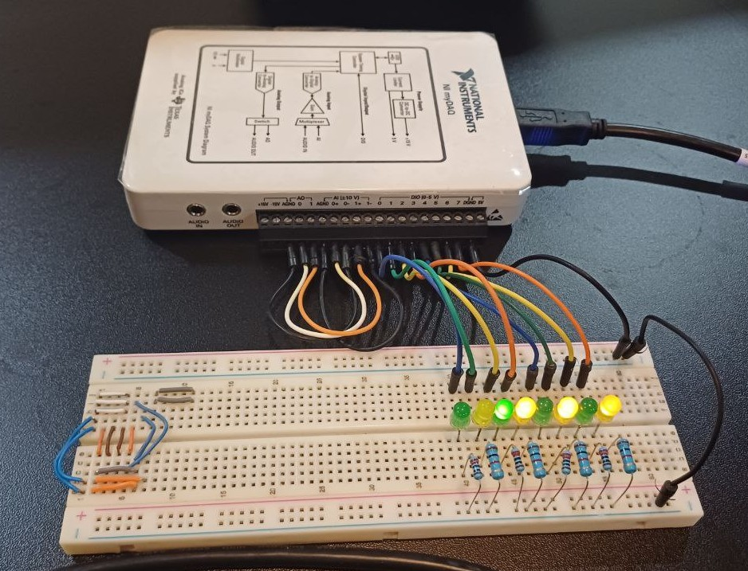
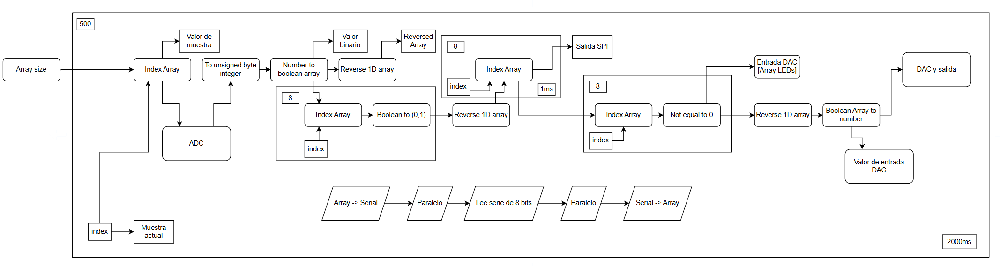
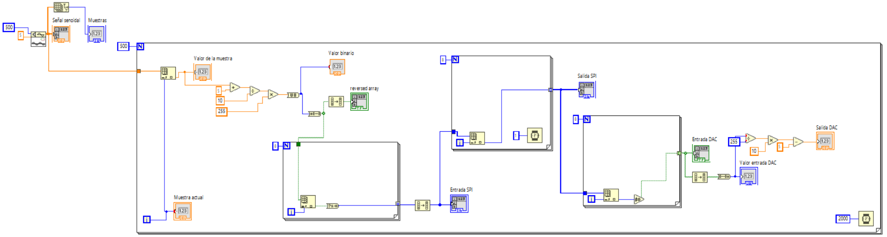
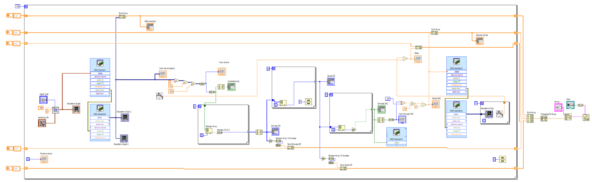

# Proyecto 3 - Digitalización de Señales, Protocolos y Retrasos
 
Prototipo que emula un sensor analógico que digitaliza una señal y la transmite por **SPI** con una frecuencia de muestreo de **1 kHz**. La señal se despliega en LEDs, se reconvierte a analógica y se compara contra la entrada para medir **retraso/desfase y precisión**. Se instrumenta con **NI myDAQ + LabVIEW** y el análisis estadístico se hace en **R**.

 
## Sistema
 
1. El myDAQ genera una señal senoidal que vuelve a entrar por una de sus entradas analógicas.
2. **ADC** (implementado en LabVIEW): 8 bits, rango de 0 V a 5 V (256 niveles, ≈19.5 mV por bit).
3. **SPI:** Un esclavo (el sensor emulado) envía cada muestra a un maestro. Una etapa de comprobación compara la salida del maestro contra la salida del ADC.
4. **LEDs:** 8 salidas digitales del myDAQ muestran el valor binario de cada muestra.
5. **DAC** (implementado en LabVIEW): Reconvierte la salida del maestro a señal analógica.
6. Se compara la entrada contra la salida punto por punto para obtener retraso y error del sistema completo.

## Parametros en LabVIEW

- En el .vi se utiliza N samples con una frecuencia de muestreo de 1kHz y 1 sample por iteración.

- La señal senoidal del generador de funciones es de 200Hz y Vp=5V.

- En el .vi y mediciones no se tomó en cuenta que la onda senoidal debía ser de 0V a 5V (Se está utilizando una de -5V a 5V (Vp=5V)).

## VI en LabVIEW
 
| Sin myDAQ (avance) |
|---|
|  |

| Con myDAQ |
|---|
|  |
 
## Estado
 
- [x] Diseño del sistema (diagrama de bloques)
- [x] VI en LabVIEW (ADC, SPI, DAC, LEDs)
- [x] Diseño del circuito (myDAQ + LEDs)
- [~] Diseño del experimento
- [x] Mediciones (`Mediciones_P3.xlsx`)
- [ ] Hipótesis nula
- [ ] Análisis estadístico en R
- [ ] Informe final 

## Contenido
 
| Archivo / carpeta | Descripción |
|---|---|
| `Imagenes/` | Diagrama de bloques, conexiones del myDAQ y capturas del VI |
| `LabVIEW/` | VI del sistema |
| `Mediciones_P3.xlsx` | Datos medidos |
| `TI_Proyecto3_Entrega_Avance.pdf` | Entrega de avance (introducción, marco teórico y descripción de la solución) |
 
**Herramientas:** NI myDAQ, LabVIEW, R.